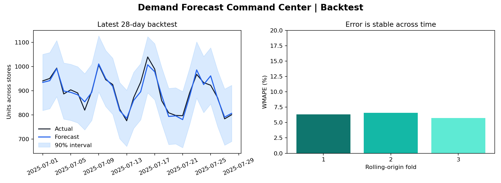

# Demand Forecast Command Center

> A retail forecasting system evaluated the way it would be used: on future time windows, with uncertainty attached.


This project forecasts daily product demand across stores using lagged demand, calendar effects, price, and promotions. Rolling-origin backtests expose performance drift across time, while conformal-style residual intervals quantify operational uncertainty.



## Business result

The output is a replenishment-ready table containing point forecasts and 90% prediction bands. WMAPE makes model quality easy to translate into planning risk, and every reported score comes from a future holdout window.

| Backtest result | Value |
|---|---:|
| Rolling-origin folds | 3 |
| Mean WMAPE | 6.21% |
| Mean absolute error | 4.65 units |
| Mean interval coverage | 88.29% |

## What this demonstrates

- Time-aware feature engineering without target leakage
- Rolling-origin backtesting across multiple store-product series
- Prediction intervals and coverage measurement
- Reproducible artifacts, Docker, and CI

## Reproduce

```bash
python -m venv .venv
source .venv/bin/activate
make install
make run
```

The included generator creates realistic multi-store demand with trend, seasonality, promotions, and price elasticity. This keeps the case study fully reproducible and makes the hidden data-generating process inspectable.

## Repository map

```text
src/demand_forecast/     simulation, features, backtest, intervals
data/                    reproducible demand snapshot
artifacts/               forecasts, fold metrics, and chart
.github/workflows/       CI reproduction job
```

## Interview discussion

Natural extensions are hierarchical reconciliation, cold-start products, inventory constraints, holiday calendars, and monitoring interval coverage after deployment.

